 

<h3><code>musab@github ~ $ ./contributions.sh</code></h3>

  

<h3><code>musab@github ~ $ whoami</code></h3>
<table>
  <tr>
    <td valign="top"></td>
    <td valign="top"></td>
  </tr>
</table>

 

<h3><code>musab@github ~ $ neofetch</code></h3>

  

<h3><code>musab@github ~ $ ./links.sh</code></h3>

 

## Featured work

**Portfolio site: [musab-abukaraki.vercel.app](https://musab-abukaraki.vercel.app)** - CV, case studies and project walkthroughs in one place.

Newest first. Every project is a case study: the question, the method, reconciled results and stated limitations. Numbers are traceable to the source data and the code in each repository.

| Built | Project | What it is | Proof |
|---|---|---|---|
| Oct 2026 | **[signalforge](https://github.com/musab-abukaraki-66/signalforge)** | End-to-end e-commerce intelligence platform: data engineering, analytics, BI, ML and decision support | Reproducible Python and SQL foundation with CI; later stages are marked planned in its roadmap |
| Oct 2026 | **[marketplace-operations-customer-experience-analytics](https://github.com/musab-abukaraki-66/marketplace-operations-customer-experience-analytics)** | Analytics case study on about 100k real e-commerce orders | SQL (DuckDB) and Python pipeline, data-quality gates, 13 business queries, CI |
| Oct 2026 | **[Mizan](https://github.com/musab-abukaraki-66/Mizan)** | Forecasting lab for Jordan's monthly CPI, built from official statistics | Transparent baseline and statistical models; bilingual (Arabic and English) interface; CI |
| Oct 2026 | **[jordanian-unemployment-2025-2026](https://github.com/musab-abukaraki-66/jordanian-unemployment-2025-2026)** · [live preview](https://musab-abukaraki-66.github.io/jordanian-unemployment-2025-2026/) | Jordanians-only, source-traced Power BI data story on official Department of Statistics releases | Ten flat quarters at 21.0-21.5%; three-page report separating definitions, periods, gender and age |
| Oct 2026 | **[hospital-atlas-ed-pressure-room](https://github.com/musab-abukaraki-66/hospital-atlas-ed-pressure-room)** | Interactive Power BI report on real CMS Care Compare data | 3,107 hospitals drawn as roses with DAX that returns SVG; no custom visuals |
| Oct 2026 | **[federal-contracting-intelligence](https://github.com/musab-abukaraki-66/federal-contracting-intelligence)** | Executive Power BI product over the full FY2025 U.S. federal prime-contract record | 6.64M contract actions and $793.2bn obligated; 13.6 GB archive into a 187 MB model |
| Oct 2026 | **[jordan-economic-pulse](https://github.com/musab-abukaraki-66/jordan-economic-pulse)** | Four-page case study of Jordan's external gap, growth and prices | Star-schema model with DAX reconciled to an independent baseline |
| Sep 2026 | **[retail-performance-intelligence](https://github.com/musab-abukaraki-66/retail-performance-intelligence)** | SQL and Python retail analytics | Window functions, CTEs and RFM segmentation; five business questions answered by executed queries |
| Sep 2026 | **[saas-subscription-bi](https://github.com/musab-abukaraki-66/saas-subscription-bi)** | Subscription BI: star schema, KPI design, dashboard analysis | MRR, churn and cohort retention; DAX measures cross-checked against executed SQL |
| Sep 2026 | **[support-ops-report-automation](https://github.com/musab-abukaraki-66/support-ops-report-automation)** | Validate, clean and transform a weekly export into Excel and PDF reports | 9 passing unit tests |
| Sep 2026 | **[ai-augmented-anomaly-insights](https://github.com/musab-abukaraki-66/ai-augmented-anomaly-insights)** | Statistical anomaly detection with an AI narration layer | A tested validator blocks the model from inventing numbers |
| Aug 2026 | **[orbit](https://github.com/musab-abukaraki-66/orbit)** · [live demo](https://orbit-ten-cyan.vercel.app) | Real-time collaborative project management for small teams | Next.js 16, Supabase (Postgres, Auth, RLS, Realtime), Playwright e2e, Vercel |
| Apr 2026 | **[aerial-car-detection](https://github.com/musab-abukaraki-66/aerial-car-detection)** | YOLOv8s fine-tuned to detect cars in aerial imagery | 96.78% mAP@0.5, 94.92% precision, 95.01% recall; pipeline, CLI and desktop GUI |

## Toolbox

| Area | Tools |
|---|---|
| **Business intelligence** | Power BI (PBIP/PBIR) · DAX · Power Query · star-schema modelling · SVG-in-DAX visuals |
| **Data and analysis** | Python · SQL · pandas · NumPy · scikit-learn · Excel · statistics |
| **Machine learning** | PyTorch · Ultralytics YOLOv8 |
| **Web and data engineering** | TypeScript · Next.js · Supabase / Postgres · Playwright · Vercel |
| **Practice** | Source tracing · reconciliation to a baseline · pytest · Git/GitHub · GitHub Actions |

## Get in touch

[Portfolio](https://musab-abukaraki.vercel.app) · [LinkedIn](https://www.linkedin.com/in/musababukaraki) · [musababukaraki1@gmail.com](mailto:musababukaraki1@gmail.com)

The art above is generated by the scripts in [`scripts/`](scripts). The contribution graph and stats card refresh daily from public data with GitHub Actions: no third-party stats service, no token, no JavaScript.
